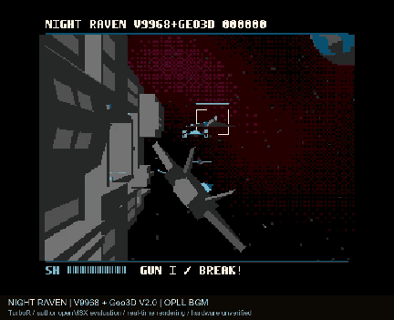

# NIGHT RAVEN — Geo3D V2.0 edition v0.1.0

既存のOPLL BGMテスト版を維持した独立版。ROM 1MiB / ASCII16。

[ROM / MP4 / GIF](https://github.com/kanon-ai/V9968_Geo3D_SampleDemo/releases/tag/night-raven-geo3d-v2-v0.1.0)

下記のGeo3D v2対応openMSXで、TurboR（Panasonic_FS-A1ST_V9968）＋geo3d拡張＋MSX-MUSICを選び、ROMをASCII16として起動します。エミュレータ・BIOSは同梱しません。

This independent edition requires Geo3D V2.0 with 1024-entry model RAM, TurboR and MSX-MUSIC. The tested author openMSX commit is listed below. Not compatible with Geo3D V1 or a 512-entry build. Physical hardware and BlueMSX+ V2 are unverified. OPLL music uses the TurboR timer; ordinary MSX2+ is not a supported BGM configuration.
Geo3D v2.0 (ID 20h)、モデルRAMのアドレス幅10bit以上が必要です。旧版・512エントリー版では実行を停止します。

## 作者の更新版
- openMSX branch geo3d-v2.0: 67811936bee936c15e3fbdbdffe01755fd349876
- Geo3D specifications branch: 885cff1fc5c3e8c38af9ac39112b7bdd73371b9e
- 作者ソースを変更せずMSVC Release x64ビルドした、既存のローカル取得物を再利用。git ls-remoteで作者の最新版と一致を確認。
- https://github.com/alexmoncks/openMSX/tree/geo3d-v2.0
- https://github.com/alexmoncks/V9968_Cartridge/blob/geo3d-v2.0/geo3d/docs/geo3d_v2.md
- 旧比較版 openMSX: de29fb854885a38251c03e24596ad4ff95770ef2
- v2は作者の開発版で、公式V9968 v1採用ファームとは区別します。本テストは実機未検証。

## 変更内容
11モデル（機体6種類＋壁5種類）、824頂点・527面をGeo3D RAMへ起動時に一度だけ転送。
XCTRL拡張モード、10bit頂点番号、12byte面形式を使用。
VFIRST/FFIRSTと個数でRUN対象を指定し、壁の毎回アップロードと機体頂点の復元・面リスト交換を廃止。
機体の共通頂点プール248頂点は維持。機体個別の頂点数への絞り込みは今後の余地です。
ROMのbank 2～63（シーン、絵、旧壁素材、音楽）はすべて旧版と一致。旧壁素材は容量削減のために除去していません。
映像・演出・BGMの内容は変更していません。BGMは従来通りTurboRタイマーを使用。

## 同条件の比較
Panasonic_FS-A1ST_V9968 / R800、ASCII16、共通share・同一BIOS、speed 100。
throttle offで待ち時間を省いていますが、計測値はホスト実時間ではなくエミュレーション時間です。
各条件の最初から最後まで511描画間隔を比較。

| 条件 | 秒 | 描画更新/秒 | Geo3D data-port writes |
|---|---:|---:|---:|
| 旧openMSX＋旧BGM ROM | 25.383525 | 20.131 | 5,039,678 |
| 新openMSX＋旧BGM ROM | 25.383338 | 20.131 | 5,039,678 |
| 新openMSX＋常駐モデルROM | 17.055555 | 29.961 | 163,210 |

改修による描画更新率は約48.8%向上。Geo3Dデータポート(9Fh)書き込みは約96.8%減。
全I/O転送量ではありません。起動時のまとめ読み込みは測定区間に含みません。
現状のフレーム待ちにより約30更新/秒に達しており、これをGeo3D自体の性能上限とは扱いません。
固定3tick進行の従来設計を維持するため、描画が速くなると飛行・演出の実時間も短くなります。BGMテンポは独立です。

## 検証
新エミュレータ上の旧ROM・改修ROMとも、旧版と全512表示VRAMページがbyte単位で一致。
OPLLの書き込み列は、記録された共通区間（2周以上）で一致。
verify_v2.pyで11モデルの全頂点・面・法線・色・インデックスの対応と、非変更ROM領域を確認。
比較結果・ROM/EXEハッシュ: comparison/results.json。
画面のホスト提示のフレーム落ちを避けるため、一致検証は描画完了時の表示VRAMを使用。

## 限界
作者openMSXでは幾何演算にエミュレーション時間を計上しません。RTLのヒープソート・除算器高速化の効果は、この計測には出ません。
今回の改善は主にCPUのモデル転送削減によるものです。実機やFPGAの速度向上率の保証ではありません。
BlueMSX+のv2版では未検証。既存の各デモは引き続き利用できます。本版は無保証の開発版です。

## BGM
Suno（Premium）で作曲し、MSXミュージックエディタのMCP機能でCodexがOPLLへ編曲した既存テスト曲を維持。
提供者の許可でデモに組み込んで公開しています。音楽データはコードのMITライセンスと別扱いです。楽曲単体の再利用権は付与していません。

Music created with Suno (Premium), arranged for OPLL by Codex through the MSX Music Editor MCP interface. Included with the contributor’s permission; separate from the MIT-licensed code.

## Build
SDCC_BINをSDCC binに設定し、Python 3 + NumPy + Pillowで python build.py。
旧BGM版 demos/night-raven-opll-test もビルドしてから python verify_v2.py を実行すると、モデル変換と未変更ROM領域、保存済み比較結果に対応するROMハッシュを検査できます。このスクリプト自体はエミュレータ比較を再実行しません。
